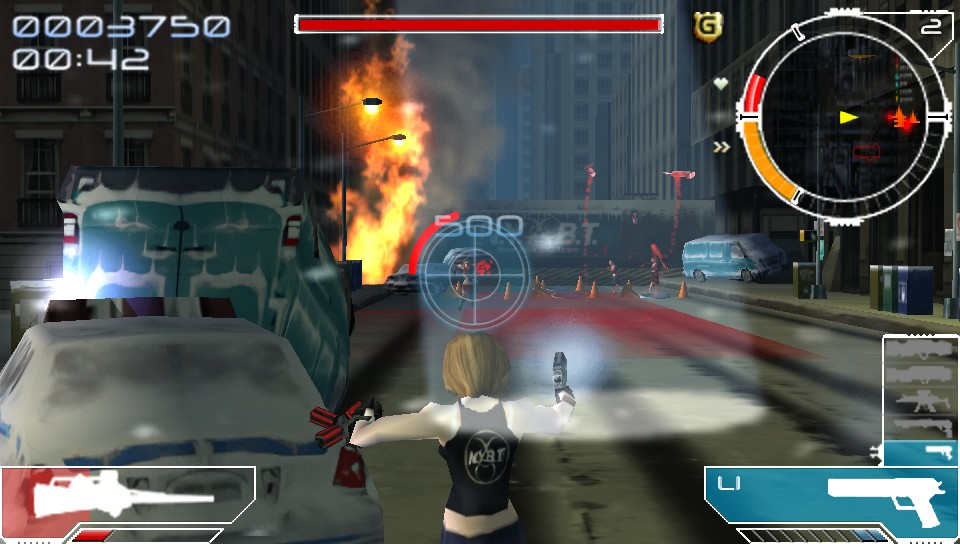
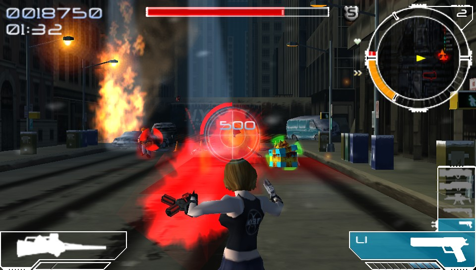
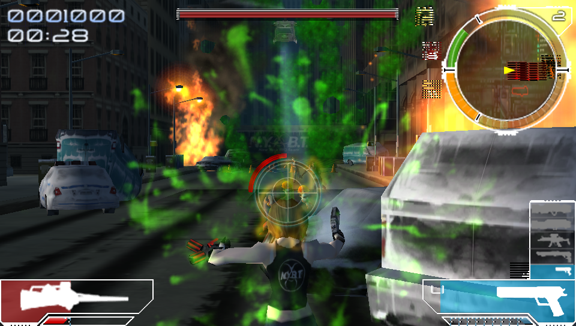
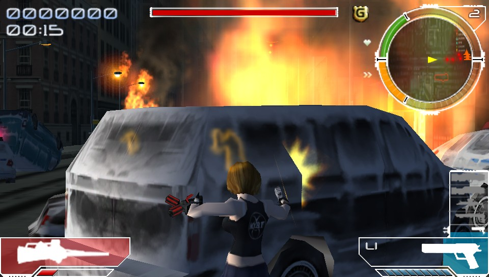
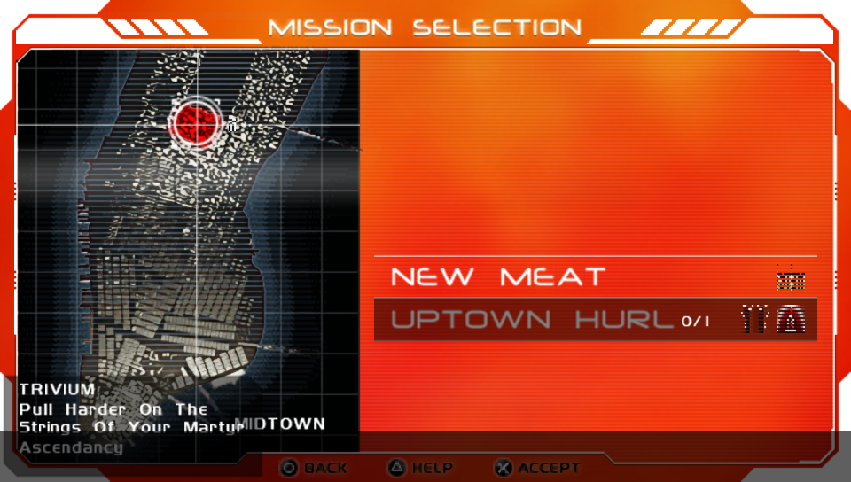
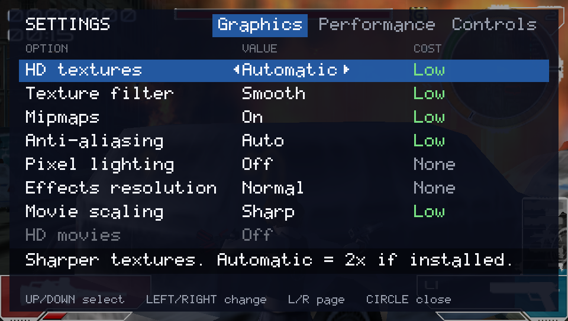
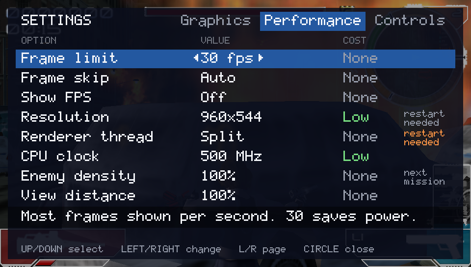
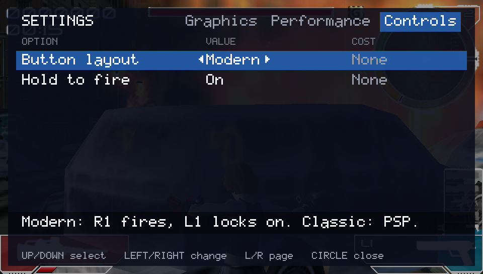

# Infected for PS Vita

**The 2005 PSP zombie shooter, running natively on the PS Vita, installed from your own disc with the CBOC Vita Installer in about 10 minutes.**
Pick your disc, press Install, and the installer builds the game on your computer and sends it to your Vita. No terminal, no Python, no SDK.
This isn't an emulator: the game's code is translated into native ARM code and runs directly on the Vita's processor, drawn by the Vita's own
GPU at the full 960x544. It comes with sharper textures made from your own disc, a modern shooter control layout and a settings menu you can
open at any moment.

**[Get the CBOC Vita Installer](https://github.com/CBOC-Vita-Lab/vita-installer/releases/latest)** · [Install guide](INSTALL.md) · [Settings menu](SETTINGS.md) · [Controls](CONTROLS.md) · [What's new](CHANGELOG.md)

You'll need your own copy of the game. The finished package contains code translated from the game, so it can't be shared as a download:
the installer builds it on your computer, from your disc, and nothing is uploaded.

## New In Version 1.1

Install is the big change: your disc in, a finished game on your Vita out, in about 10 minutes. The picture got smoother too, with nothing to set.

- **Install in about 10 minutes.** The [CBOC Vita Installer](https://github.com/CBOC-Vita-Lab/vita-installer) (version 2.0) builds Infected on your own computer from your own disc. It
  checks the disc the moment you pick it, asks you to press **Allow**, downloads a 40-50 MB builder once, builds the game (9 to 9.5 minutes on
  a slow 2-core PC, faster on most computers) and sends it to your Vita. Windows, macOS and Linux.
- **Smoother edges, by default.** Anti-aliasing is now **Auto**: FXAA is on while the GPU has room, switches off for the heavy moments, and as a last step the
  3D scene is drawn at 85% for a few seconds while the HUD stays sharp.
- **A lighter FXAA.** 5 to 7 screen reads instead of 9, and about half the shader maths. On a real Vita, mission 1 with FXAA and the 2x textures held 30 fps (give or take 1) for
  164 of 181 seconds. Version 1.0's FXAA ran at 21 to 30 fps, mostly in the mid-20s.
- **Less wasted work.** The PSP's alpha test is skipped wherever it can't fail (draws covering 71% of the alpha-tested area instead of 46%, with a pixel-identical picture).
  Recoloured HD textures are stored compressed: 8 times less memory for them, and 2.4 times less HD texture memory overall in a mission-1 sample (7.8 down to 3.3 MB).
  The newest vitaGL (2 November 2026) is in too.
- **500 MHz without fuss.** With the PSVshellPlus plugin installed, the game sets up its own 500 MHz profile and never overwrites one of yours. It takes effect from the next
  start, and the menu shows the clock it measured (495 MHz on a real Vita).
- **Fixes.** The HD textures row no longer shows greyed out at start. If the shader compiler or memory is missing, the boot screen says so in plain words.
  Every one of the 18 menu rows and 46 values was tested.
- **Nothing to turn on.** Everything above is already on if you never open Settings.

## Screenshots

| | |
| --- | --- |
|  |  |
| Street fighting in mission 1, 2x HD textures | The viral gun in action |
|  |  |
| Fire and frost in Manhattan | Mission selection |

All pictures are at the Vita's 960x544 and drawn by the port's own renderer. The shots above were rendered on a PC from recorded
mission frames, with the same drawing code the Vita runs.

## By The Numbers

| | |
| --- | --- |
| **About 10 minutes** | to install from your own disc with the CBOC Vita Installer (9 to 9.5 minutes on a slow 2-core PC; faster on most computers) |
| **30 fps for 164 of 181 seconds** | mission 1 on a real Vita with FXAA and the 2x textures (give or take 1 fps), against 21 to 30 for version 1.0's FXAA (version 1.1) |
| **5 to 7 screen reads** | for the new FXAA, instead of 9, with about half the shader maths (version 1.1) |
| **7.8 to 3.3 MB** | HD texture memory in a mission-1 sample, 2.4 times less (version 1.1) |
| **495 MHz** | the clock the menu measured on a real Vita with the PSVshellPlus profile (version 1.1) |
| **4 CPU cores** | the game, its graphics, the drawing, and the sound and music each get their own |
| **4x the pixels** | 960x544 instead of the PSP's 480x272 |
| **9,577** | game functions translated into native code, checked against the original with 57,462 random tests and 10,562 recorded game states |
| **13-20 ms** | the game's own work per frame, out of the 33 ms a 30 fps frame has (version 1.0) |
| **2,625** | textures in the 2x HD pack, built from your disc |
| **1.5 seconds** | to prepare every shader during the opening logos, so effects never pause the game later (version 1.0) |
| **3 menu pages, 18 options** | picture, speed and controls, changeable mid-game; every row and all 46 values tested (version 1.1) |

<!-- TODO-VITA: console run of this week: mission 1 on the new defaults (anti-aliasing Auto, no pack and with the 2x pack): fps over the whole mission and the share of time FXAA is on (log line `aa=auto:on(...)`). Replace the "30 fps for 164 of 181 seconds" row if the default run gives a better headline. -->
<!-- TODO-VITA: the game's own work per frame (ms) on 1.1; the "13-20 ms" row is from 1.0. -->

## What To Expect

| | |
| --- | --- |
| **Gameplay** | Mission 1 held 30 fps (give or take 1) for 164 of 181 seconds with FXAA and the 2x textures on a PS Vita. Version 1.0 held 30 on every second with FXAA off. A short stutter can still happen in the heaviest moments. <!-- TODO-VITA: mission 1 on the 1.1 defaults (Auto): fps for the whole run --> |
| **Picture** | 960x544 with smooth filtering and anti-aliasing on Auto. Pixel lighting, MSAA and double-resolution effects look nicer but cost frames (see below). The defaults are tuned for a steady 30. |
| **Menus and movies** | All the game's menus and movies work. The intro movie can show thin horizontal lines. |
| **Saves** | The game's own saves, kept in `ux0:data/infected/`. Updates never touch them. |
| **Missions** | Mission 1 has been played start to finish on a Vita. The later missions run in the PC build and should work, but haven't been played on a console yet. |

**Pick your style** (measured on a PS Vita in mission 1):

| Setup | Frames per second | For |
| --- | --- | --- |
| **Defaults** (anti-aliasing Auto; the 2x textures if you made the pack) | 1.0's defaults (anti-aliasing off) held **30, every second**. The 1.1 defaults add Auto; their full-mission figure is still to come <!-- TODO-VITA: fps of the 1.1 defaults in mission 1 --> | Playing. This is the recommended setup. |
| **FXAA always on** + 2x textures | **30 (give or take 1) for 164 of 181 seconds** in 1.1; 1.0's FXAA ran 21 to 30, mostly in the mid-20s | Smoother edges if you want them on every frame |
| **Everything on** (4x textures, FXAA, pixel lighting, double effects) | 10 to 14 (version 1.0) | Screenshots, not play |
<!-- TODO-VITA: the "everything on" run again on 1.1, if the new FXAA moves it -->

60 fps isn't possible: the game itself runs at 30. The frame limit is already 30 by default, which keeps the motion even.
See [Known Issues](KNOWN-ISSUES.md) for everything that is still rough, and [report a problem](https://github.com/CBOC-Vita-Lab/infected-vita/issues/new/choose) if you find something new.

## Install

**You need:**
- a Vita or PS TV with HENkaku or Ensō, and VitaShell;
- the [CBOC Vita Installer](https://github.com/CBOC-Vita-Lab/vita-installer/releases/latest) (version 2.0 or newer) on a Windows 64-bit PC, a Mac (macOS 10.13 or newer on Intel, 11 or newer on Apple silicon) or a Linux 64-bit PC, about 1 GB of free disk space while it builds;
- your own **Infected** disc image (US version, ULUS-10054, 1.02) as an `.iso`. A Vita has no UMD drive, so step 1 shows how to copy your disc.

**Five steps:**
1. **Dump your UMD.** On a PSP 1000, 2000 or 3000 with custom firmware such as [ARK](https://github.com/PSP-Archive/ARK-4): put the UMD in, press **SELECT** on the home
   screen to open the VSH menu and set **USB Device** to **UMD Disc**, open **Settings > USB Connection**, and copy the `.iso` from the drive that appears on your computer. CSO and PBP files don't work.
2. **Open the installer** on your computer, and VitaShell on your Vita (press **SELECT** there so the installer can find it).
3. **Pick Infected** and choose your `.iso`. The installer checks it straight away: wrong version, damaged copy or CSO/PBP, and you're told on the spot.
4. **Press Install, then Allow.** The installer downloads the builder (40-50 MB, once), builds the game from your disc in about 10 minutes and sends it to the Vita.
   Nothing leaves your computer. If it offers **Prepare your Vita**, that installs ShaRKBR33D for the optional shader compiler (see [INSTALL.md](INSTALL.md)).
5. **Play.** Open the **Infected** bubble on the Vita's home screen.

**On another computer, or want the file yourself?** The release has the same builder for each system, `infected-build`. On Windows, drag your `.iso` onto it; elsewhere run
`infected-build Infected.iso`. It writes `infected.vpk`, and every system makes the byte-identical game. Computers the installer can't build on (32-bit or ARM Windows, ARM Linux)
can build on another machine and choose the finished `infected.vpk` in the installer. Developers who want to build everything by hand: [docs/BUILDING.md](docs/BUILDING.md).

**Updating?** Install the new version the same way, or install the new VPK over the old one. Your saves and settings stay.

[INSTALL.md](INSTALL.md) has the details: free space, the optional extras, doing it by hand and what the boot screen's messages mean.

## Playing

| Button | Modern layout (default) |
| --- | --- |
| Left stick | Move |
| **R** | Fire (hold for automatic fire) |
| **L** | Lock on and strafe |
| Square | Viral gun |
| Right stick up / down | Map |
| START | Pause (the game's own menu) |
| **SELECT + START** (hold) or **tap the top-right corner** | Settings menu |
| **START + SELECT + L + R** (hold) | Leave the game |

### The settings menu

Hold **SELECT + START** for half a second, or tap the **top-right corner** of the touch screen. The game pauses and the menu opens on top of it.

| | | |
| --- | --- | --- |
|  |  |  |

| Page | What's on it |
| --- | --- |
| **Graphics** | HD textures (Automatic / 2x / 4x / Off), texture filter, mipmaps, anti-aliasing (**Auto**, FXAA, MSAA 2x/4x), pixel lighting, effects resolution, movie scaling |
| **Performance** | Frame limit (30 / 60 / off), frame skip, an on-screen FPS counter, resolution (960x544 or 720x408), renderer threads, CPU clock (444 / 500 MHz, with the measured clock shown), enemy density (up to 200 %), view distance (up to 200 %) |
| **Controls** | Modern or Classic (PSP) button layout, hold-to-fire |

**Up/Down** chooses a row, **Left/Right** changes it, **L/R** switches page and **Circle** closes the menu and saves. Each row shows a short
explanation, and settings that would need a restart say so. **[SETTINGS.md](SETTINGS.md) explains every option**: what it does, what it
costs on the Vita (measured where we could), and which ones to turn off first if the game slows down.

### Optional extras

- **HD textures (optional, and slow to make).** The packs are built from your own disc on a PC, which takes hours. The installer can send them with the game; see [HD-TEXTURES.md](HD-TEXTURES.md).
- **500 MHz.** Install PSVshellPlus yourself and the game sets up its own 500 MHz profile (it never overwrites yours), from the next start. See [INSTALL.md](INSTALL.md).
- **RetroFlow.** The game adds its own cover and background to RetroFlow the first time it starts, and never replaces pictures you've set yourself.
- **Your own bubble art.** The installer lets you pick your own pictures for the bubble and background. Developers can also build the package with their own; see [docs/BUILDING.md](docs/BUILDING.md).

## For Developers

| | |
| --- | --- |
| [docs/BUILDING.md](docs/BUILDING.md) | `infected-build`, and the full manual build from disc to VPK |
| [builder/README.md](builder/README.md) | How `infected-build` and its kits work |
| [docs/STATUS.md](docs/STATUS.md) | What runs where, with every console measurement and its date |
| [docs/ARCHITECTURE.md](docs/ARCHITECTURE.md), [docs/GL_RENDERER.md](docs/GL_RENDERER.md) | How it works: recompiler, system layer, the split renderer |
| [vita/README-VITA.md](vita/README-VITA.md) | Every `config.txt` switch, the log lines, benchmarks and the test bot |
| [patches/portablekit/](patches/portablekit) | The changes to [PortableKit](https://github.com/TeamGDB/PortableKit), applied by `scripts/get-portablekit.sh` |

Source layout: `builder/` (`infected-build`, the one-program builder), `recomp/` (MIPS to C++ recompiler), `port/` (the game's profile and tuning), `vita/` (the Vita app, platform layer, fourth-core
module and library scripts), `tools/` (HD texture and movie builders, test drivers), `docs/history/` (the development logs).

## Credits

Built by AI agents. The code and documents were written by **Claude** (Anthropic), directed and play-tested on a real PS Vita by a human.
It stands on [PortableKit](https://github.com/TeamGDB/PortableKit) by TeamGDB, [vitaGL](https://github.com/Rinnegatamante/vitaGL) by
Rinnegatamante, FFmpeg, VitaSDK, taiHEN and the Vita homebrew community. The fourth-core unlock follows
[CapUnlocker](https://github.com/GrapheneCt/CapUnlocker) by GrapheneCt. [CREDITS.md](CREDITS.md) has the full list.

*Infected* was developed by Planet Moon Studios and published by Majesco Entertainment. This is an unofficial fan project, not affiliated
with or endorsed by them or by Sony Interactive Entertainment. It contains none of the game: build and play it only with a copy you own.
The code is MIT-licensed ([LICENSE](LICENSE)); a built package links vitaGL (GPL-3.0) and FFmpeg (LGPL-2.1+)
([THIRD_PARTY_NOTICES.md](THIRD_PARTY_NOTICES.md)).
