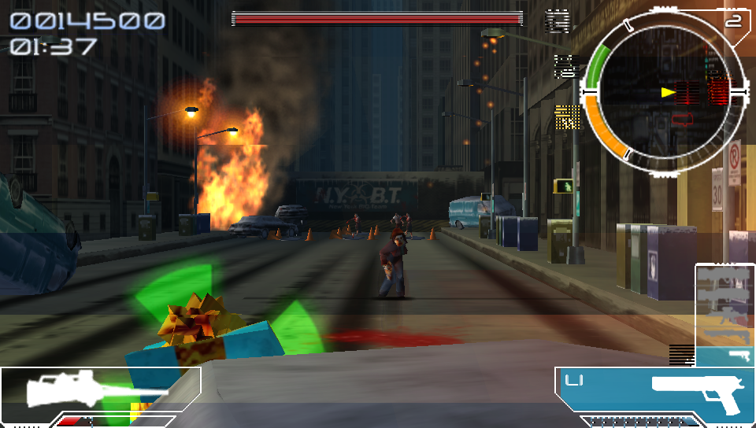

# Infected for PS Vita

**The 2005 PSP zombie shooter, running natively on the PS Vita.** This isn't an emulator. The game's code is translated into native ARM code
and runs directly on the Vita's processor, and its graphics are drawn by the Vita's own GPU at the full 960x544. It runs at a steady 30 fps on
all four of the Vita's CPU cores. It comes with sharper textures made from your own disc, a modern shooter control layout, and a settings menu
you can open at any moment.

Mission 1, captured on a PS Vita.

**[Build it from your disc](docs/BUILDING.md)** · [Install guide](INSTALL.md) · [Settings menu](SETTINGS.md) · [Controls](CONTROLS.md) · [What's new](CHANGELOG.md)

You'll need your own copy of the game. The finished package contains code translated from the game, so it can't be shared as a download.
You build it once, from your own disc, on a PC.

## New In Version 1.0

The first public version: the whole game, native, at 30 frames a second.

- **A steady 30 fps.** On the default settings, mission 1 on a real Vita showed 30 pictures in every second, the game's own rate on the PSP.
- **All four CPU cores, nothing extra to install.** The game unlocks the Vita's normally reserved fourth core by itself and hands it the
  audio, the music decoder and the movie decoder. The game, the preparation of its graphics and the drawing each get a core of their own.
- **A settings menu, any time.** Hold **SELECT + START**, or tap the **top-right corner** of the screen. The game pauses, and you can change the
  picture, speed and controls on the spot. [Every option is explained here.](SETTINGS.md)
- **Sharper textures.** Optional HD packs (2x or 4x) are made from your own disc and swapped in live, with no restart.
- **Modern shooter controls.** **R** fires, **L** locks on and strafes, the right stick opens the map. Hold R for automatic fire. The original
  PSP layout is one switch away.
- **No first-time stutter.** Shaders are prepared during the opening logos, so effects don't make the game pause when they first appear.
- **Extra picture options:** FXAA or MSAA anti-aliasing, per-pixel lighting, finer glow effects, smooth texture filtering and mipmaps.
- **500 MHz mode.** With a PSVshellPlus profile, the CPU runs above Sony's usual 444 MHz limit.

## What To Expect

| | |
| --- | --- |
| **Gameplay** | 30 fps in mission 1 on the default settings, measured on a PS Vita. A short stutter can still happen in the heaviest moments. |
| **Picture** | 960x544 with smooth filtering. FXAA, MSAA, pixel lighting and double-resolution effects look nicer but cost frames: with all of them on it drops to 10-14 fps. The defaults are tuned for a steady 30. |
| **Menus and movies** | All the game's menus and movies work. The intro movie can show thin horizontal lines. |
| **Saves** | The game's own saves, kept in `ux0:data/infected/`. Updates never touch them. |
| **Missions** | Mission 1 has been played start to finish on a Vita. The later missions run in the PC build and should work, but haven't been played on a console yet. |

60 fps isn't possible: the game itself runs at 30. The frame limit is already 30 by default, which keeps the motion even.
See [Known Issues](KNOWN-ISSUES.md) for everything that is still rough.

## Install

**You need:**
- a Vita or PS TV with HENkaku or Ensō, and VitaShell;
- `libshacccg.suprx` in `ur0:data/`, the shader compiler every vitaGL game needs;
- your own **Infected** disc image (US version, ULUS-10054, 1.02) as an ISO;
- a PC to build the package on (tested on Linux; about 20 minutes on two cores).

**Four steps:**
1. **Build `infected.vpk`** from your disc: [docs/BUILDING.md](docs/BUILDING.md). The game's code is translated on your PC; nothing
   from the game is downloaded.
2. **Install it.** Copy the VPK to the Vita, open it in VitaShell and press **Cross**.
3. **Add your game.** Copy the ISO into `ux0:data/infected/`.
4. **Play.** Open the **Infected** bubble.

**Updating?** Just install the new VPK over the old one. Your saves and settings stay.

[INSTALL.md](INSTALL.md) has the details: free space, the optional extras and what the boot screen's messages mean. The CBOC Vita
Installer doesn't handle Infected yet, because there is no ready-made package to install.

## Playing

| Button | Modern layout (default) |
| --- | --- |
| Left stick | Move |
| **R** | Fire (hold for automatic fire) |
| **L** | Lock on and strafe |
| Square | Viral gun |
| Right stick up / down | Map |
| START | Pause (the game's own menu) |
| **SELECT + START** (hold) or **tap the top-right corner** | Settings menu |
| **START + SELECT + L + R** (hold) | Leave the game |

### The settings menu

Hold **SELECT + START** for half a second, or tap the **top-right corner** of the touch screen. The game pauses and the menu opens on top of it.

| Page | What's on it |
| --- | --- |
| **Graphics** | HD textures (Automatic / 2x / 4x / Off), texture filter, mipmaps, anti-aliasing (FXAA, MSAA 2x/4x), pixel lighting, effects resolution, movie scaling |
| **Performance** | Frame limit (30 / 60 / off), frame skip, an on-screen FPS counter, resolution (960x544 or 720x408), renderer threads, CPU clock (444 / 500 MHz), enemy density (up to 200 %), view distance (up to 200 %) |
| **Controls** | Modern or Classic (PSP) button layout, hold-to-fire |

**Up/Down** chooses a row, **Left/Right** changes it, **L/R** switches page and **Circle** closes the menu and saves. Each row shows a short
explanation, and settings that would need a restart say so. **[SETTINGS.md](SETTINGS.md) explains every option**: what it does, what it
costs on the Vita (measured where we could), and which ones to turn off first if the game slows down.

### Optional extras

- **HD textures.** Build `texpack_2x.bin` or the mixed `texpack_4x.bin` from your disc and copy them into `ux0:data/infected/`. See [HD-TEXTURES.md](HD-TEXTURES.md).
- **500 MHz.** Install PSVshellPlus and copy the included profile. See [INSTALL.md](INSTALL.md).
- **RetroFlow.** The game adds its own cover and background to RetroFlow the first time it starts, and never replaces pictures you've set yourself.
- **Your own bubble art.** Build the package with pictures made from your disc or any picture you like. See [docs/BUILDING.md](docs/BUILDING.md).

## For Developers

| | |
| --- | --- |
| [docs/BUILDING.md](docs/BUILDING.md) | The full build, from disc to VPK |
| [docs/STATUS.md](docs/STATUS.md) | What runs where, with every console measurement and its date |
| [docs/ARCHITECTURE.md](docs/ARCHITECTURE.md), [docs/GL_RENDERER.md](docs/GL_RENDERER.md) | How it works: recompiler, system layer, the split renderer |
| [vita/README-VITA.md](vita/README-VITA.md) | Every `config.txt` switch, the log lines, benchmarks and the test bot |
| [patches/portablekit/](patches/portablekit) | The changes to [PortableKit](https://github.com/TeamGDB/PortableKit), applied by `scripts/get-portablekit.sh` |

Source layout: `recomp/` (MIPS to C++ recompiler), `port/` (the game's profile and tuning), `vita/` (the Vita app, platform layer, fourth-core
module and library scripts), `tools/` (HD texture and movie builders, test drivers), `docs/history/` (the development logs).

## Credits

Built by AI agents. The code and documents were written by **Claude** (Anthropic), directed and play-tested on a real PS Vita by a human.
It stands on [PortableKit](https://github.com/TeamGDB/PortableKit) by TeamGDB, [vitaGL](https://github.com/Rinnegatamante/vitaGL) by
Rinnegatamante, FFmpeg, VitaSDK, taiHEN and the Vita homebrew community. The fourth-core unlock follows
[CapUnlocker](https://github.com/GrapheneCt/CapUnlocker) by GrapheneCt. [CREDITS.md](CREDITS.md) has the full list.

*Infected* was developed by Planet Moon Studios and published by Majesco Entertainment. This is an unofficial fan project, not affiliated
with or endorsed by them or by Sony Interactive Entertainment. It contains none of the game: build and play it only with a copy you own.
The code is MIT-licensed ([LICENSE](LICENSE)); a built package links vitaGL (GPL-3.0) and FFmpeg (LGPL-2.1+)
([THIRD_PARTY_NOTICES.md](THIRD_PARTY_NOTICES.md)).
