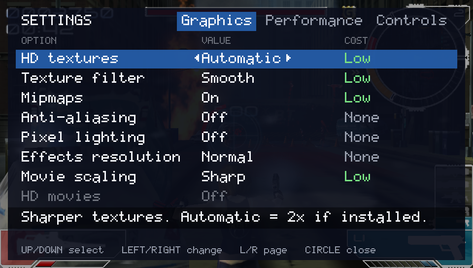
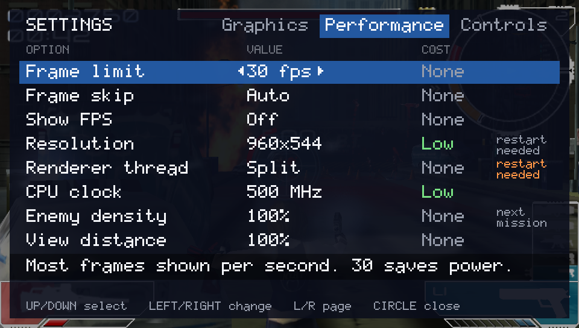
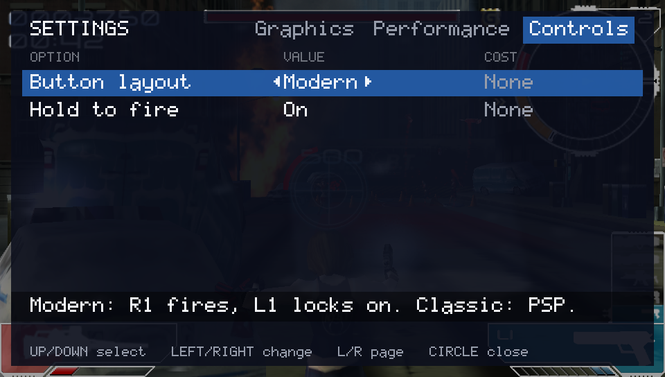

# The settings menu and the performance options

The port has its own settings menu on top of the game. It covers the picture, speed, controls and some gameplay options. This page describes:

* how to open the menu;
* what each row does and what it costs;
* the speed features that are always on;
* the extra switches for testers.

## Opening the menu

* **Hold SELECT + START** for half a second, **or**
* **tap the top-right corner** of the front touch screen.

It works anywhere, in a mission or in the game's own menus. The game **pauses** while the menu is open: its clock stops and so does the sound. Close the menu and the game carries on from the same moment.

| Button | In the menu |
| --- | --- |
| UP / DOWN | choose a row |
| LEFT / RIGHT | change the value |
| L / R | switch page (**Graphics**, **Performance**, **Controls**) |
| CIRCLE or START | close the menu and save |

* Each row has a one-line explanation under the list. A row in **grey** can't be used right now; the reason is shown in its place, for example "No texture pack installed".
* Your choices are saved in `ux0:data/infected/settings.txt`. **Delete that file to go back to the defaults.**
* **Coming from version 1.0:** anti-aliasing is **Auto** now. If you never changed anything in the menu, you get Auto by itself at the first start. If you did change
  something, your anti-aliasing stays as it was (the old menu saved every row, so the port can't tell a chosen Off from an untouched one): pick **Auto** in the menu if you want it.
* A value marked **restart needed** takes effect the next time you start the game.

> **SELECT + START opens the menu. It does not quit.** To leave the game, hold **START + SELECT + L + R** for about a second. That
> ends the game cleanly and saves the end of `log.txt`. Closing it from the home screen also works, but the last lines of the log can be lost.

## Recommended settings

**The defaults are the setting for a steady 30 fps and the best picture that holds it.** HD textures (Automatic: the 2x pack when it is installed), smooth
texture filter, mipmaps, effects Normal, frame limit 30, frame skip Auto, the Split renderer and the CPU at 500 MHz (it falls back to 444 by itself when the
system refuses) are all on or chosen for you. **Anti-aliasing is Auto**: the game turns FXAA on while the Vita's graphics chip has room for it, and off again the
moment a scene needs the time, so you get smoother edges without losing frames.

These were measured on a PS Vita (firmware 3.74) in mission 1 on 23 October 2026:

| Settings | Frames shown per second |
| --- | --- |
| Defaults of version 1.0 (HD textures Automatic with the 2x pack, anti-aliasing **Off**, pixel lighting Off, effects Normal) | **30, every second of the mission** |
| 2x pack + the first version of **FXAA**, always on | 21 to 30 |
| 4x pack + FXAA + pixel lighting + effects Double, all together | **10 to 14**: the graphics chip can't keep up |

**Not measured on a console yet:** Auto itself and the cheaper FXAA it uses (about half the texture reads of the first version). Auto is built so that it can't make
a scene slower than Off for more than a moment (it goes off after two late pictures, and `log.txt` says when: `[aa] auto: fxaa off ...`), but how often it has FXAA on in a
mission is for the first console test to show.

The expensive options are **Pixel lighting**, **MSAA 4x**, **FXAA always on** and **Effects resolution: Double**. They make the picture nicer but the
Vita's graphics chip can't do them all and still hold 30. Turn one on at a time, and turn **Show FPS** on to see what it costs.

**Cost** in the tables below means how much slower an option makes the game: None, Low, Medium or High. A cost that was **measured** says so. The rest
are estimates.

## Graphics page

| Option | Values (Vita default in bold) | What it does | Cost |
| --- | --- | --- | --- |
| **HD textures** | **Automatic**, Off, 2x pack, 4x pack | Replaces the game's textures with sharper ones from `texpack_2x.bin` or `texpack_4x.bin` in `ux0:data/infected/` (made from your own disc, see [`docs/BUILDING.md`](docs/BUILDING.md)). **Automatic** uses the 2x pack if it is there, else the 4x pack. Changes in a few seconds, no restart. Grey when no pack is installed. | 2x: Low (it holds 30 in mission 1). 4x: Medium |
| **Texture filter** | **Smooth**, Original | Smooth: the 3D world is filtered smoothly instead of in blocky pixels. The HUD, menus and text stay exactly as the game draws them. Original: what the PSP shows. | Low |
| **Mipmaps** | **On**, Off | Smaller copies of each texture for faraway ground and walls, so they don't shimmer. Uses about a third more texture memory. | Low |
| **Anti-aliasing** | **Auto**, Off, FXAA, MSAA 2x, MSAA 4x | Smooths jagged edges. **Auto** uses FXAA while the graphics chip has room and switches it off while it doesn't (the row shows **Auto (on)** or **Auto (off)**); it never loses you frames for long and never needs a restart. **FXAA** is the same filter always on, over the finished picture; it changes at once. **MSAA** is done by the graphics chip and needs a **restart**; Auto never picks it. | Auto: Low (it backs off by itself). FXAA always on: Medium to High (the first version measured 21-30 fps; the cheaper one is not measured yet). MSAA 2x: Medium. MSAA 4x: High |
| **Pixel lighting** | **Off**, On | Lights characters per pixel instead of per corner of their triangles: smoother highlights. The most expensive option. The first time each lit material appears it also builds a new shader, a short pause the first time only. | High |
| **Effects resolution** | **Normal**, Double | The resolution of the hidden pictures behind the glow and blur effects. Double makes glows finer. | Medium |
| **Movie scaling** | **Sharp**, Bilinear | How the original 480x272 movies are enlarged to the screen. Sharp keeps edges crisp; Bilinear is softer. | Low |
| **HD movies** | **Off**, On | **Experimental.** Plays 960x544 versions of the 18 movies if you have made them (`tools/hdmovies`). Grey when they are not installed. Not yet run on a console. | Low |

## Performance page

| Option | Values (Vita default in bold) | What it does | Cost |
| --- | --- | --- | --- |
| **Frame limit** | 60 fps, **30 fps**, Off | The most pictures shown per second. **30** is the game's own rate on the PSP; a steady 30 looks smoother than a rate that jumps between 27 and 34. **60** lets the drawing run faster when it can, but the game itself still runs at 30, so the motion is no smoother. **Off** stops waiting for the screen's refresh, so the picture can tear; use it only to see what the Vita can do. | None |
| **Frame skip** | **Auto**, Off | When the drawing can't keep up, the game leaves a picture undrawn and carries on at its own speed. The action and the sound stay steady and only the picture gets choppier. It does nothing while the drawing keeps up. Off: the game waits for every picture and slows down instead. Only with the **Split** renderer. | None |
| **Show FPS** | **Off**, On | A counter in the top-left corner: pictures per second, milliseconds per picture and the number of draws. | Low |
| **Resolution** | **960x544**, 720x408 | The size the 3D picture and the HUD are drawn at. 720x408 draws 56 % of the pixels and is enlarged to the screen: a softer picture, less work for the graphics chip. **Restart needed.** | 960x544: Low |
| **Renderer thread** | **Split**, On, Off | **Split** (the Vita's default and the fastest): the game runs on one CPU core, reading the game's drawing commands on a second, and the drawing itself on a third. **On**: the drawing has one core of its own. **Off**: everything on one core, only for hunting a problem. Mission 1: 29-31 fps with Split against 25 with On. **Restart needed.** | None |
| **CPU clock** | 444 MHz, **500 MHz** | The Vita's processor speed. 444 MHz is the normal maximum; 500 MHz gives every core about 12 % more time and needs a plugin that lifts the limit (`INSTALL.md`). Without one the system refuses and the game stays at 444, which `log.txt` says. Runs warmer and uses more battery. | None (faster) |
| **Enemy density** | **100%**, 125%, 150%, 200% | How many enemies can be alive at once in an area: 4 in mission 1 at 100 %, 8 at 200 %. **It applies at the next mission** (or a retry after you die). The mission's total enemies, goals and medals stay the game's own. | 125 %: Medium. 150 % and 200 %: High |
| **View distance** | **100%**, 150%, 200% | How far the world is drawn before the fog hides it. Changes at once. In mission 1 (a closed street) you mostly see less haze; in open levels more of the skyline stays visible. | 150 % and 200 %: Medium (estimate) |

## Controls page

| Option | Values (default in bold) | What it does |
| --- | --- | --- |
| **Button layout** | **Modern**, Classic | **Modern** is a shooter layout for the Vita's shoulder buttons: **R** fires (the PSP's Cross), **L** locks on and strafes (the PSP's R), and **the right stick up or down** opens the map (the PSP's L). Every other button keeps its PSP meaning, so Cross still fires too. **Classic** is the PSP layout unchanged. |
| **Hold to fire** | **On**, Off | With the Modern layout, holding **R** keeps firing (ten shots a second) instead of one shot per press. |

The left stick is the PSP's analog nub in both layouts. None of the controls options cost any speed.

## Speed features that are always on

These need no setting. Each has a switch in `config.txt` (below) to turn it off for testing.

| Feature | What it does |
| --- | --- |
| **Three cores, four when the system allows** | The game, the reading of its drawing commands, and the drawing run on three separate cores. The game also unlocks the Vita's **fourth core** for itself with a small module inside the package (`module/infected_core3.skprx`, firmware 3.60-3.74, unloaded when the game quits). Nothing to install. Audio, the movie decoder and the music decoder then run on core 3. |
| **Music decoded ahead** | The game's ATRAC3plus music and voices are decoded one frame early on the helper core, so the game's own core doesn't spend about 3 ms of every frame on it. |
| **Shaders prepared at start** | The package lists the shader programs the game uses. They are prepared during the logos, so a mission doesn't pause the first time an effect appears. The FXAA shader (for Auto and FXAA) is prepared there too; pixel lighting's are added to the list the first time they are used. |
| **Invisible draws skipped** | Sprites and effects the game has faded to fully transparent are not sent to the graphics chip. |
| **Alpha tests dropped when they can't fail** | A draw whose pixels can never be rejected by the game's alpha test is drawn without the test: a shorter, faster program, the same picture. |
| **Frame skip, 30 fps frame limit, Split renderer, 500 MHz** | The defaults of the Performance page above: a steady 30, a late picture is left undrawn so the game and the sound keep their pace, and the most CPU time the Vita allows. |
| **Anti-aliasing Auto** | FXAA only while it fits (see the Graphics page). |
| **Compact vertices, fewer state changes** | 3D models are sent to the graphics chip without the vertex data their shader doesn't read. The graphics library is not asked to set again the state the previous draw already set. |

## Settings for testers (`config.txt`)

A text file `ux0:data/infected/config.txt` with `name=value` lines changes things for the whole run. The file is optional; normal play doesn't need it. Lines that matter for speed tests:

| Line | What it does |
| --- | --- |
| `gfx.anything=value`, `perf.anything=value`, `controls.anything=value` | Fixes a menu setting for the run (for example `gfx.antialiasing=off`, which also stops Auto). The menu shows that value and can't change it, and it isn't saved. |
| `core3_unlock=0` / `core3=0` | Doesn't load the fourth-core module (core 3 is then used only if another plugin already allows it) / never uses core 3. |
| `atrac_ahead=0` | Decodes the music on the game's own core (for comparisons). |
| `gl_skip_invisible=0` | Draws the fully transparent sprites anyway. |
| `gl_compact_vertices=0`, `gl_vgl_skip_redundant=0`, `gl_rt_scenes=0`, `gl_alpha_elide=0`, `gl_alpha_elide_range=0` | Turn off the other drawing speed-ups, to compare. `log.txt` lists them in its `[gl] speed features:` line. |
| `gl_aa_auto=0` / `gl_aa_auto=2` | Anti-aliasing Auto behaves as Off (the way it was before Auto existed) / as FXAA always. `gfx.antialiasing=off` fixes the menu row to Off. |
| `gl_fxaa_quality=high` | The first, dearer version of the FXAA filter. |
| `log_sync=1` | Saves every log line as it is written. Slower; use it when the game crashes, so the last lines are kept. |

`vita/README-VITA.md` has the full list (benchmarks, the play-testing bot, diagnostics) and explains the log lines. [`vita/release/config.txt.example`](vita/release/config.txt.example)
is a ready file with every line switched off.

## How the texture options work together

* A texture from an HD pack keeps the smaller copies stored in the pack. Turning **Mipmaps** off uses only its full-size picture.
* **Texture filter = Original** with an HD pack: HD textures are still shrunk smoothly (blocky shrinking would shimmer badly at four times the size). When they are enlarged, the game's own choice decides.
* If the game is slow, turn off, in this order: **Pixel lighting**, **MSAA 4x / FXAA always on** (Auto already gets out of the way by itself), **Effects resolution: Double**, then the **4x pack** (use 2x).

## The HD texture packs

| File in `ux0:data/infected/` | Size | What it is |
| --- | --- | --- |
| `texpack_2x.bin` | 72.2 MB | 2,625 textures at twice the size. **Automatic** uses this one. |
| `texpack_4x.bin` | 102.4 MB | The *mixed* pack: world, props and effects at four times the size, characters and menus at twice. |

The full 4x pack (274 MB) is for PCs and doesn't fit the Vita's texture memory; the game warns in `log.txt` if it finds one.

**Texture memory.** The packs may use 32 MB (2x) or 48 MB (4x) of graphics memory. Textures that don't fit stay as they were; nothing breaks.
Textures of a mission you have left are freed after about ten seconds.

**If the game crashes, stutters or shows white textures:** set HD textures to Off first, then MSAA, then Pixel lighting, then anti-aliasing to Off.
